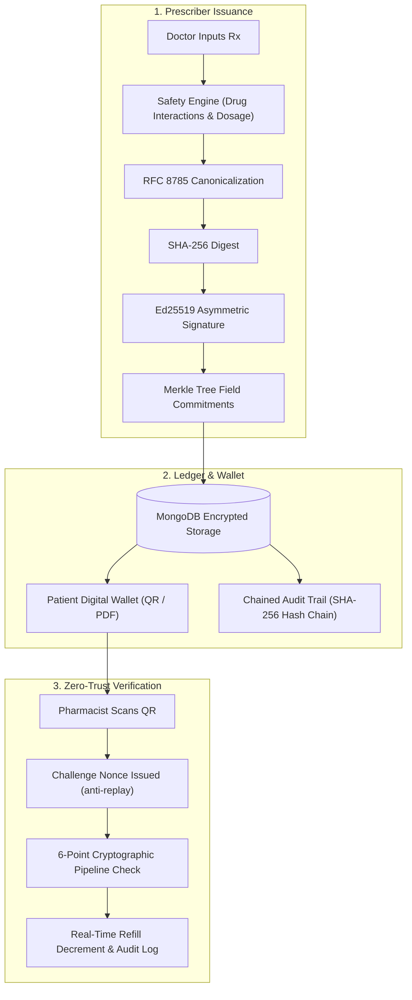

# MediShare

**Zero-Trust Cryptographic Healthcare Credentialing & Anti-Tamper Verification Architecture**

[](https://www.typescriptlang.org/)
[](https://react.dev/)
[](tests/security-attacks.test.ts)
[-success.svg)](tests/)
[](api/_lib/crypto-utils.js)
[](https://www.w3.org/TR/vc-data-model-2.0/)
[](api/_lib/audit-chain.js)
[-38B2AC.svg)](eslint.config.js)
[](LICENSE)

---

## Table of Contents

1. [Executive Overview](#executive-overview)
2. [Threat Model & Real-World Problem](#threat-model--real-world-problem)
3. [System Architecture & Applied Cryptography](#system-architecture--applied-cryptography)
4. [Enterprise Security Enhancements](#enterprise-security-enhancements)
   - [A. Cryptographically Chained Audit Trail](#a-cryptographically-chained-audit-trail)
   - [B. Privacy-Preserving Selective Disclosure (Merkle Trees)](#b-privacy-preserving-selective-disclosure-merkle-trees)
   - [C. Anomaly Detection & Impossible Travel Alerts](#c-anomaly-detection--impossible-travel-alerts)
   - [D. Client-Side Non-Custodial Key Generation (Zero-Trust)](#d-client-side-non-custodial-key-generation-zero-trust)
   - [E. Cloud KMS / HSM Abstraction Layer](#e-cloud-kms--hsm-abstraction-layer)
5. [OWASP Top 10 Automated Attack Test Suite](#owasp-top-10-automated-attack-test-suite)
6. [Open Standards: W3C & HL7 FHIR Interoperability](#open-standards-w3c--hl7-fhir-interoperability)
7. [User Roles & Access Control (RBAC)](#user-roles--access-control-rbac)
8. [Pre-Configured Demo Accounts](#pre-configured-demo-accounts)
9. [Step-by-Step Quick Start](#step-by-step-quick-start)
10. [REST API Reference](#rest-api-reference)
11. [Project Directory Structure](#project-directory-structure)
12. [Security Documentation Links](#security-documentation-links)
13. [License](#license)

---

## Executive Overview

**MediShare** is a zero-trust healthcare credentialing architecture that replaces paper prescriptions and vulnerable legacy electronic systems with **tamper-evident, cryptographically verifiable digital credentials**.

Using **Ed25519 asymmetric cryptography** and **RFC 8785 JSON Canonicalization**, licensed prescribers issue tamper-proof prescriptions directly to patient wallets. Pharmacists verify digital credentials in milliseconds via a 6-point cryptographic check, real-time dispensation tracking, and challenge-response nonces—guaranteeing authenticity and eliminating double-dispensing without requiring shared database passwords or phone verifications.

---

## Threat Model & Real-World Problem

### Vulnerabilities in Traditional Systems
* **Prescription Forgery & Dosage Tampering:** Adversaries alter dosages (e.g. `5 mg` altered to `50 mg`) or duplicate clinic letterheads.
* **Double-Dispensing ("Doctor Shopping"):** Patients present photocopies or re-use paper slips across multiple retail pharmacies.
* **Lack of Non-Repudiation:** Providers or pharmacies can deny having authored or dispensed scheduled medications.
* **Excessive Information Disclosure:** Patients must disclose their entire diagnostic and medication history just to pick up a single prescription.
* **Silent Database Tampering:** Compromised database administrators or attackers with SQL/NoSQL access can modify historical audit records.

### MediShare's Defense Architecture
* **Cryptographic Locks:** Every prescription is canonicalized (RFC 8785), SHA-256 hashed, and signed with the prescriber's Ed25519 private key. A single-bit alteration invalidates the signature.
* **Challenge-Response Nonce Handshake:** Verification requires single-use, time-bound cryptographic nonces to prevent QR capture and replay attacks.
* **Tamper-Evident Chained Audit Trail:** Audit logs form an append-only cryptographic hash chain. Any historical record alteration breaks the chain.
* **Selective Disclosure:** Patients disclose only chosen fields to a verifier using Merkle tree cryptographic proofs, preserving diagnostic privacy.
* **Impossible Travel & Rapid Scan Detection:** Real-time privacy-preserving telemetry flags geographically conflicting or automated brute-force scans.



---

## System Architecture & Applied Cryptography

### 1. Deterministic Canonicalization (RFC 8785 JCS)
In standard JavaScript runtimes, JSON key order and formatting are non-deterministic. MediShare implements RFC 8785-compliant JSON Canonicalization (`api/_lib/crypto-utils.js`) ensuring object keys are lexicographically sorted and whitespace is normalized before computing SHA-256 digests.

### 2. Ed25519 Asymmetric Digital Signatures
Prescriptions are signed using **Ed25519** (Edwards-curve Digital Signature Algorithm):
* Equivalent security to ~3072-bit RSA with a fraction of the computational overhead.
* 64-byte compact signatures suitable for high-density 2D QR codes.
* Mathematical immunity to side-channel timing attacks and signature malleability.

### 3. Envelope Encryption at Rest (AES-256-GCM)
Doctor private keys are protected at rest using **AES-256-GCM** authenticated symmetric encryption with unique 16-byte initialization vectors (IV) and authentication tags, governed by a Key Encryption Key (KEK) or Cloud KMS.

### 4. 6-Point Cryptographic Verification Pipeline
During verification (`/api/verify/exchange`), MediShare executes 6 sequential checks:
1. **Issuer Key Resolution:** Resolves the provider's active public key from the cryptographic keystore.
2. **Signature Verification:** Reconstructs the canonical digest and validates the Ed25519 signature.
3. **Data Integrity Inspection:** Compares stored hash against real-time database state to detect internal tampering.
4. **Revocation Registry:** Verifies the credential has not been canceled by the provider or an administrator.
5. **Temporal Expiration Check:** Verifies validity dates (`issued_at` $\le \text{now} \le$ `expires_at`).
6. **Dispensation Quota:** Verifies remaining refills exceed zero before permitting medication release.

---

## Enterprise Security Enhancements

### A. Cryptographically Chained Audit Trail
Audit logs in [`api/_lib/audit-chain.js`](file:///c:/Users/dhruv/Downloads/agon-agent_1-4ade177c/api/_lib/audit-chain.js) are linked via a SHA-256 forward-chaining cryptographic hash chain:
$$\text{Hash}_n = \text{SHA-256}\Big(\text{CanonicalData}_n + \text{PrevHash}_{n-1} + \text{Timestamp}_n\Big)$$
* **Genesis Anchor:** First entry starts with `"GENESIS"`.
* **Concurrency Lock:** In-module Promise-chain mutex (`withLock`) prevents race conditions during high-volume parallel writes.
* **Tamper-Evidence:** Altering, deleting, or reordering any historical audit entry breaks all forward hashes.
* **Verification Utility:** Run `node scripts/verify-audit-chain.js` or `GET /api/audit/verify` (Admin-only).

### B. Privacy-Preserving Selective Disclosure (Merkle Trees)
Implemented in [`api/_lib/selective-disclosure.js`](file:///c:/Users/dhruv/Downloads/agon-agent_1-4ade177c/api/_lib/selective-disclosure.js) and [`src/lib/selectiveDisclosure.ts`](file:///c:/Users/dhruv/Downloads/agon-agent_1-4ade177c/src/lib/selectiveDisclosure.ts):
* Each prescription field is blinded with a random 16-byte salt:
  $$\text{Leaf}_i = \text{SHA-256}\Big(\text{Salt}_i + \text{":"} + \text{FieldName}_i + \text{":"} + \text{FieldValue}_i\Big)$$
* A binary Merkle tree is constructed and the Merkle root is stored with the credential.
* **Patient Privacy:** A patient can generate a cryptographic proof demonstrating authentic prescription of an antibiotic, while completely hiding psychiatric co-prescriptions, clinical notes, and unrelated medications.

### C. Anomaly Detection & Impossible Travel Alerts
Implemented in [`api/_lib/anomaly-detection.js`](file:///c:/Users/dhruv/Downloads/agon-agent_1-4ade177c/api/_lib/anomaly-detection.js) and [`api/_routes/verify.js`](file:///c:/Users/dhruv/Downloads/agon-agent_1-4ade177c/api/_routes/verify.js):
* **Privacy-Preserving Telemetry:** Raw IP addresses are **never stored**. Instead, salted hashes (`hashIp()`) and coarse network regions are recorded.
* **Impossible Travel:** Flags when the same credential is confirmed from geographically conflicting network regions within 10 minutes.
* **Rapid Scan Detection:** Flags automated scanning if a credential is probed $\ge 5$ times in 2 minutes.
* **Non-Blocking:** Anomaly checks execute asynchronously and never delay medical treatment.
* **Administrative Audit:** Incidents are reviewed at `/api/admin/security-alerts`.

### D. Client-Side Non-Custodial Key Generation (Zero-Trust)
Implemented in [`src/lib/clientCrypto.ts`](file:///c:/Users/dhruv/Downloads/agon-agent_1-4ade177c/src/lib/clientCrypto.ts) and [`api/_routes/providers.js`](file:///c:/Users/dhruv/Downloads/agon-agent_1-4ade177c/api/_routes/providers.js):
* Doctors generate Ed25519 key pairs locally in their browser using the **Web Cryptography API** (`crypto.subtle`).
* Private keys are stored in non-extractable client IndexedDB storage.
* Only the SPKI public key is transmitted to the server via `POST /api/providers/register-key`.
* **Zero-Trust Advantage:** Even in the event of a total server database breach, an attacker cannot forge doctor signatures.

### E. Cloud KMS / HSM Abstraction Layer
Located in [`api/_lib/kms/`](file:///c:/Users/dhruv/Downloads/agon-agent_1-4ade177c/api/_lib/kms/):
* Decouples application logic from key storage through a unified interface.
* **Local Adapter:** Active development adapter with AES-256-GCM envelope encryption.
* **Cloud KMS Stubs & Guides:** Ready-to-activate adapters for **AWS KMS** (Customer Master Keys) and **HashiCorp Vault** (Transit Secrets Engine).

---

## OWASP Top 10 Automated Attack Test Suite

Located in [`tests/security-attacks.test.ts`](file:///c:/Users/dhruv/Downloads/agon-agent_1-4ade177c/tests/security-attacks.test.ts), this suite executes **52 live attack simulations** against the server:

```
✓ OWASP API1 (BOLA)                 — Cross-patient credential/audit probes rejected (401/403)
✓ OWASP API2 (Broken Auth)           — Malformed JWTs, empty tokens, and invalid signatures rejected
✓ OWASP API3 (Schema Bypass)         — Negative refills and corrupted data types rejected (400)
✓ OWASP API4 (DoS / Rate Limit)      — 200+ rapid requests trigger sliding-window HTTP 429
✓ OWASP API5 (Broken Access Control) — Privilege escalation attempts blocked
✓ Signature Replay Attack            — Re-using verification nonces rejected on second attempt
✓ NoSQL Injection                    — Query operators ({"$gt": ""}) stripped prior to query execution
✓ Tamper Detection                   — Modifying dosage invalidates signature immediately
✓ Security Misconfiguration          — Uncaught errors sanitized; zero stack traces exposed
✓ Sensitive Data Exposure            — Password hashes and private keys sanitized from API output
```

To execute all tests:
```bash
npm run test
```

---

## Open Standards: W3C & HL7 FHIR Interoperability

### 1. W3C Verifiable Credentials (VC v2.0)
Export any prescription as an internationally interoperable W3C Verifiable Credential via `GET /api/credentials/:id/export/vc`:
```json
{
  "@context": [
    "https://www.w3.org/ns/credentials/v2",
    "https://w3id.org/security/suites/ed25519-2020/v1"
  ],
  "id": "urn:uuid:c9c52004-6fb3-4654-8fbd-2bd360802816",
  "type": ["VerifiableCredential", "PrescriptionCredential"],
  "issuer": { "id": "did:web:medishare.example:provider:68a1b2..." },
  "validFrom": "2026-08-30T10:00:00Z",
  "validUntil": "2027-10-29T10:00:00Z",
  "credentialSubject": {
    "id": "did:web:medishare.example:patient:PAT-1001",
    "prescription": {
      "medications": [{ "medication": "Amoxicillin", "dosage": "500 mg", "refills": 1 }]
    }
  },
  "proof": {
    "type": "Ed25519Signature2020",
    "verificationMethod": "did:web:medishare.example:provider:68a1b2#key-1",
    "proofValue": "9qmsUyspzPYXwvojSl8qYrX2B8ZnJmd68yVuTTyr8sJmEyD4DlfcI0gp7kEFFInnSPj..."
  }
}
```

### 2. HL7 FHIR R4 Bundle
Export prescriptions as FHIR R4 `MedicationRequest` bundles (`/api/credentials/:id/export/fhir`) for EHR integration (Epic, Cerner).

---

## User Roles & Access Control (RBAC)

| Role | Default Dashboard | Key Permissions |
|---|---|---|
| **Provider (Doctor)** | `/provider` | Prescribe medications, sign Ed25519 credentials, register client keys, revoke compromised credentials |
| **Patient** | `/patient` | View credential wallet, generate presentation QR codes, download vector verification PDFs |
| **Pharmacist** | `/verify` | Scan QR codes, verify 6-point cryptographic proof, record dispensations against PIN |
| **Admin** | `/admin` | Approve providers, verify cryptographic audit chain, review security alerts & anomaly events |

---

## Pre-Configured Demo Accounts

All pre-seeded demo accounts share the password: **`password123`**

| Role | Email | Password | Primary Test Capabilities |
|---|---|---|---|
| **Doctor** | `dr.sharma@medishare.com` | `password123` | Create multi-item prescriptions, test drug conflict guards |
| **Patient** | `john.doe@medishare.com` | `password123` | Inspect wallet, test QR presentation & PDF download |
| **Pharmacist** | `pharmacist@medishare.com` | `password123` | Verify benchmark UUID `c9c52004-6fb3...` with PIN `839214` |
| **Admin** | `admin@medishare.com` | `password123` | Verify audit chain integrity, inspect security alerts & stats |

---

## Step-by-Step Quick Start

### Prerequisites
* **Node.js** v20+ or v22 LTS
* **MongoDB** 7.0 running locally on port `27017` (or MongoDB Atlas connection string)

### 1. Clone & Install
```bash
git clone https://github.com/your-username/medishare.git
cd medishare
npm install
```

### 2. Configure Environment Variables
Copy `.env.example` to `.env`:
```bash
# Linux / macOS:
cp .env.example .env

# Windows PowerShell:
Copy-Item .env.example .env
```

Your default `.env` configuration:
```env
MONGODB_URI=mongodb://127.0.0.1:27017
MONGODB_DB_NAME=medishare
NODE_ENV=development
JWT_SECRET=your-secure-jwt-secret-at-least-32-chars-long
REFRESH_SECRET=your-secure-refresh-secret-at-least-32-chars-long
KEY_ENCRYPTION_KEY=your-secure-kek-key-at-least-32-chars-long
KMS_PROVIDER=local
```

### 3. Initialize Indexes & Seed Data
```bash
# 1. Setup MongoDB database indexes & uniqueness constraints
node scripts/setup-indexes.js

# 2. Seed realistic clinical data, providers, and cryptographic keys
node scripts/seed.js

# 3. Setup security alerts indexes
node scripts/setup-security-alerts-index.js

# 4. Initialize and verify the cryptographic audit chain
node scripts/migrate-audit-chain.js --rebuild
node scripts/verify-audit-chain.js
```

### 4. Start Application
```bash
npm run dev
```
Open **`http://localhost:5173`** in your browser.

### 5. Run Security & Test Suites
```bash
# Run all 106 automated unit, cryptographic, and attack tests
npm run test

# Run code linter
npm run lint

# Verify production build
npm run build
```

---

## REST API Reference

The backend exposes 28 hardened REST endpoints:

### Authentication & Identity
* `POST /api/auth/register` — Register patient or healthcare provider
* `POST /api/auth/login` — Authenticate and receive short-lived JWT (15m) + HttpOnly refresh cookie (7d)
* `POST /api/auth/refresh` — Rotate refresh token cookie and issue new access token
* `POST /api/auth/logout` — Invalidate session and clear refresh cookie

### Prescriptions & Credentials
* `GET  /api/prescriptions` — List paginated prescriptions (Provider/Admin/Patient)
* `POST /api/prescriptions` — Create prescription with drug interaction safety checks
* `GET  /api/credentials` — List user's verifiable credentials
* `POST /api/credentials` — Issue and digitally sign Ed25519 credential
* `GET  /api/credentials/:id` — Fetch credential details
* `GET  /api/credentials/:id/qr` — Generate verification QR payload
* `GET  /api/credentials/:id/export/vc` — Export W3C Verifiable Credential (v2.0)
* `GET  /api/credentials/:id/export/fhir` — Export HL7 FHIR R4 MedicationRequest Bundle
* `GET  /api/credentials/:id/compare` — Visual diff inspection comparing issued signature vs. current state
* `POST /api/credentials/:id/revoke` — Revoke credential with reason code (Provider/Admin)
* `GET  /api/credentials/:id/sd-commitments` — Retrieve Merkle commitments and salts for selective disclosure
* `POST /api/credentials/:id/sd-proof` — Verify selective disclosure Merkle proof without exposing hidden fields

### Verification & Dispensation
* `POST /api/verify/init` — Issue single-use challenge nonce (anti-replay guard)
* `POST /api/verify/exchange` — Execute 6-point cryptographic verification pipeline & anomaly checks
* `GET  /api/verify/:credentialId` — Public verification status lookup
* `POST /api/dispensations` — Dispense medication with Patient Pickup PIN verification
* `GET  /api/dispensations/:id` — Retrieve dispensation audit receipt

### Healthcare Providers
* `GET  /api/providers` — List approved healthcare providers (Authenticated)
* `GET  /api/providers/pending` — List providers pending administrative license approval (Admin)
* `POST /api/providers/:id/approve` — Approve provider license and activate credentials (Admin)
* `POST /api/providers/register-key` — Register client-side non-custodial Ed25519 public key (Provider)
* `GET  /api/providers/:id/keys` — View key rotation history (Provider/Admin)

### Administration & Audit
* `GET  /api/admin/stats` — Platform metrics (active, revoked, verifications)
* `GET  /api/admin/security-alerts` — List impossible travel and rapid scan alerts (Admin)
* `POST /api/admin/security-alerts/:id/review` — Mark security alert as reviewed (Admin)
* `GET  /api/audit` — Searchable audit logs (Provider/Admin)
* `GET  /api/audit/verify` — Validate cryptographic audit hash chain integrity (Admin)

---

## Project Directory Structure

```
medishare/
├── api/                           # Backend serverless API architecture
│   ├── _lib/                      # Security & cryptographic infrastructure
│   │   ├── anomaly-detection.js   # Privacy-preserving impossible travel & rapid scan telemetry
│   │   ├── audit-chain.js         # Cryptographically chained hash log & mutex
│   │   ├── crypto-utils.js        # Ed25519, RFC 8785 JCS, AES-256-GCM, SHA-256
│   │   ├── db-client.js           # Resilient MongoDB client connection pool
│   │   ├── env-check.js           # Production environment validator
│   │   ├── kms/                   # Cloud KMS / HSM abstraction layer
│   │   │   ├── aws-adapter.stub.js# AWS KMS integration stub & guide
│   │   │   ├── index.js           # Dynamic adapter factory interface
│   │   │   ├── local-adapter.js   # Production local AES-256-GCM adapter
│   │   │   ├── README.md          # KMS deployment architecture documentation
│   │   │   └── vault-adapter.stub.js # HashiCorp Vault transit engine stub
│   │   ├── selective-disclosure.js# Merkle tree commitment & proof verification scheme
│   │   └── utils.js               # JWT, bcrypt, rate limiting, defense headers, RBAC
│   ├── _routes/                   # Route handlers (auth, audit, credentials, verify...)
│   └── index.js                   # Central request router & middleware
├── scripts/                       # Database migrations & administrative CLI tools
│   ├── migrate-audit-chain.js     # Chained audit trail migration script
│   ├── seed.js                    # Clinical data & key pair generator
│   ├── setup-indexes.js           # MongoDB unique index enforcement
│   ├── setup-security-alerts-index.js # Security alerts index setup
│   └── verify-audit-chain.js      # CLI audit chain integrity validator
├── src/                           # Frontend web application (React 19 + TypeScript)
│   ├── components/                # Reusable UI components & modals
│   ├── contexts/                  # AuthContext, API fetch wrappers
│   ├── lib/                       # Frontend cryptographic & clinical engines
│   │   ├── clientCrypto.ts        # Client-side Web Cryptography non-custodial PKI
│   │   ├── drugWarnings.ts        # Clinical conflict & dosage guard rules
│   │   └── selectiveDisclosure.ts # Client-side Merkle proof generator
│   └── pages/                     # Role-based dashboards (Provider, Patient, Verify...)
├── tests/                         # Vitest automated test suite (106 tests)
│   ├── api-e2e.test.ts            # Full end-to-end API integration tests
│   ├── crypto.test.ts             # Cryptographic primitive tests
│   ├── drug-warnings.test.ts      # Clinical rules engine tests
│   ├── security-attacks.test.ts   # 52 OWASP Top 10 API Security attack simulations
│   ├── security-headers.test.ts   # Defense-in-depth HTTP headers tests
│   └── w3c-fhir.test.ts           # W3C Verifiable Credentials & FHIR tests
├── SECURITY.md                    # Formal security policy & disclosure procedures
├── THREAT_MODEL.md                # STRIDE threat model & attack surface documentation
└── vite.config.ts                 # Vite + Tailwind + serverless API dev server
```

---

## Security Documentation Links

* **[Threat Model (STRIDE Methodology)](THREAT_MODEL.md):** Complete analysis of sensitive assets, trust boundaries, attack scenarios, and residual risk assessments.
* **[Security Policy & Operations (SECURITY.md)](SECURITY.md):** Vulnerability disclosure protocol, key management requirements, and environment security rules.
* **[KMS Architecture (api/_lib/kms/README.md)](api/_lib/kms/README.md):** Enterprise Cloud Key Management Service migration guide.

---

## License

This project is licensed under the MIT License — see the [LICENSE](LICENSE) file for details.
